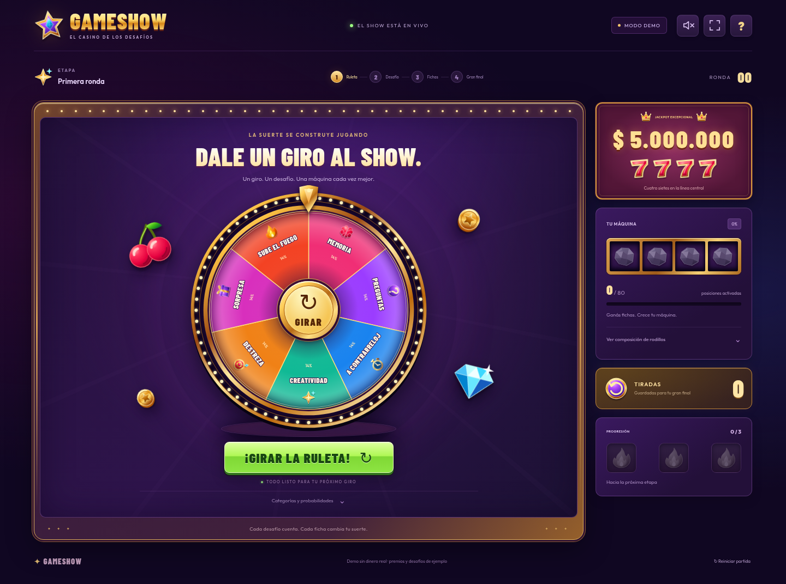

# Gameshow — demo funcional

Webapp local, sin backend ni dependencias de ejecución. Requiere **Node.js 22 o posterior**.

**Demo online:** https://ferrommu.github.io/casino-game/

GitHub Pages publica automáticamente el build de producción después de cada push a `master`, siempre que pasen las pruebas del dominio. El workflow también permite un despliegue manual desde Actions. Las partidas siguen ejecutándose íntegramente en el navegador.

## Probar la demo

```bash
git clone https://github.com/FerRomMu/casino-game.git
cd casino-game
npm run dev
```

Abrir **http://localhost:5173**. No hace falta ejecutar `npm install`.

Si ya tenés el repo clonado, ejecutá `git pull` antes de `npm run dev`.

La partida se ejecuta en memoria. Cada carga obtiene una semilla nueva del navegador. Para reproducir una partida, configurar `ui.randomSeed: false`: se utiliza `seed` del mismo JSON. El servidor sólo entrega archivos estáticos; no implementa lógica del juego ni una API.



[Ver tragamonedas](docs/ui-slots.png) · [Ver tabla con máquina completa](docs/ui-prizes.png) · [Ver versión móvil](docs/ui-mobile.png)

## Qué se puede probar

- Dos ruletas con sectores ponderados: el tamaño visual y la selección usan las mismas probabilidades normalizadas.
- Elección automática y animada de una carta boca abajo que abre directamente el desafío, con una sola opción para pasar o indicar que no se completó, retos binarios y resultados numéricos.
- Conversión automática de puntos en extracciones del tablero 7 × 7, incorporación de especiales y reemplazo de piedras en cuatro rodillos de veinte posiciones.
- Tabla de premios encima de los rodillos, actualizada durante cada incorporación. Muestra sólo importes alcanzables por la composición actual, incluyendo Wild y multiplicador; las combinaciones imposibles quedan apagadas y el jackpot exige el símbolo excepcional en cada rodillo. En pantallas bajas se conserva la fila central que paga para mantener legibles la tabla y los controles.
- Ruleta con sectores de colores, relieve dorado, luces animadas e iconos por categoría. Símbolos ilustrados en SVG, tipografías locales y máquina con rodillos profundos y columnas doradas.
- Animaciones de cartas, selección de fichas, vuelos reales hacia el inventario y los rodillos, reemplazos del tablero, fuego y premios. Las fichas recogidas se muestran después de extraerse; los rodillos frenan de a uno.
- Protección frente a clicks repetidos durante las secuencias. La ayuda se puede abrir durante las animaciones sin reemplazar ni interrumpir la escena en curso.
- Tras cada recompensa se incorporan los símbolos y se actualizan la tabla y la barra. Si aumenta el premio máximo alcanzable, aparece una animación con el nuevo valor. Cada tirada ganada espera a que el jugador pulse «¡GIRAR!» y suma su premio al pozo acumulado, visible durante toda la partida. Si no se ganó ninguna, se vuelve a la ruleta.
- Primera ruleta adaptativa: la categoría de avance permanece disponible y crece gradualmente con el llenado. La tercera llama permite elegir pasar o continuar; la cuarta obliga a pasar. Al alcanzar el 90% cambia de etapa automáticamente, conservando las fichas excedentes para incorporarlas en la segunda ruleta.
- Las tiradas ganadas frenan de izquierda a derecha y resaltan los símbolos que pagan (incluidos Wild y un único multiplicador). Durante cada tirada se muestran el pozo acumulado y el máximo alcanzable con las tiradas pendientes; ambos se actualizan al terminar de frenar, sin revelar el resultado durante el giro.
- La cuarta categoría de la segunda ruleta es un desafío normal. La partida sigue hasta que están instalados todos los símbolos y se ganaron las cinco tiradas disponibles. Después de incorporar la última recompensa y jugar sus tiradas se muestra el premio total, sin otro giro de ruleta. También se comprueba al entrar desde la primera ruleta. La condición se configura con `final.autoFinishWhenComplete`, `slots` y `final.maxSpins`.
- Juego ajustado a `100dvh`, sin scroll de página, con título y sonido dentro del gabinete, fondo texturado y una barra animada que muestra el avance total de los símbolos instalados. La barra es vertical en escritorio y horizontal en pantallas compactas. Diseño adaptable y preferencia `prefers-reduced-motion`.
- Efectos de sonido opcionales, silenciados al iniciar, pantalla completa y reinicio con confirmación. El resultado numérico muestra su premio y conserva el foco del teclado, incluidos sus límites.

## Configuración

Todos los valores del juego y el contenido provisional están en `content/`:

| Archivo | Contenido |
| --- | --- |
| `game.config.json` | Pesos, símbolos, inventario, composición objetivo, pagos, progresión, efectos, cantidad de tiradas y tiempos principales de animación. |
| `cards_wheel_1.json` | Cartas, categoría, clave de texto, resolución y recompensas de la primera ruleta. |
| `cards_wheel_2.json` | Cartas de la segunda ruleta. La categoría final se resuelve directamente. |
| `strings.json` | Textos de interfaz, categorías, desafíos, nombres e iconos de símbolos. |

### Cambiar las probabilidades

Modificar `wheels.<wheel_id>.categories[].weight`. Los pesos estáticos se normalizan: no tienen que sumar cien. Por ejemplo, pesos `33` y `67` representan 33 % y 67 %; pesos `1` y `2` representan un tercio y dos tercios. Un peso cero oculta el sector y excluye la categoría del sorteo. Pesos negativos y ruletas sin peso positivo se rechazan al cargar. En la primera ruleta, el modo adaptativo controla la probabilidad de la categoría de progresión y conserva las proporciones entre las demás; para usar sólo pesos estáticos, configurar `progression.adaptive.enabled: false`.

La función `wheelSectors` produce tanto los límites utilizados por el dibujo SVG como los utilizados por el sorteo. Los porcentajes de la leyenda se redondean sólo para mostrarlos.

### Progresión adaptativa de la primera ruleta

`progression.adaptive` configura la curva suave elegida tras las simulaciones; ver [comparación y Q25 por perfil](research/progression/SMOOTH.md):

- `minimumFill: 0` elimina el bloqueo: la categoría permanece disponible incluso después de dos llamas. `maximumFill: 0.9` mantiene el pase obligatorio al incorporar 72 de las 80 posiciones.
- `curve`: puntos `[llenado, probabilidad]`, interpolados linealmente. La curva suave usa 0,5% hasta 40% de llenado, 2% al 50%, 6% al 60%, 18% al 70%, 40% al 80% y 65% al 90%, sin saltos de habilitación. Los porcentajes de la UI admiten un decimal (`ui.wheelProbabilityDigits`).
- `pityFrom: 0.6`, `perMiss: 0.0025`, `probabilityCeiling: 0.75`: desde 60% de llenado, cada giro sin llama suma 0,25 puntos porcentuales, hasta 75%. Al salir una llama se reinicia; los giros anteriores al 60% no acumulan esta bonificación.
- La ruleta y su leyenda usan `wheelCategories(state, config)`. Durante el giro se conserva la geometría del sorteo: la siguiente probabilidad sólo aparece al volver a la ruleta.
- Una recompensa grande se divide por unidades: se incorporan fichas hasta el límite, se muestra el cambio de etapa y se incorporan todas las restantes en la segunda ruleta. No se descartan unidades ni se reemplazan símbolos instalados. El excedente puede dejar la segunda ruleta por encima del 90%, como en la simulación; nunca completa la primera.

El dominio expone la fase `wheel_transition` y la acción `ADVANCE_WHEEL`. La UI anima el resultado, usando `ui.timings.wheelTransition`. Después de incorporar el excedente se muestra el nuevo máximo si cambió y cada tirada ganada espera a que el jugador pulse «¡GIRAR!»; luego se vuelve a la ruleta o se pasa al final si ya se completaron la máquina y las tiradas ganadas.

### Cartas y contenido

Las cartas usan `text_key` y `category`; ninguna regla depende del texto del desafío. `resolution: "binary"` utiliza `reward.success` / `reward.failure`. `resolution: "numeric"` utiliza `maximum` y `reward.byResult`: la posición del arreglo indica la cantidad cumplida, incluyendo cero. `reward.success` y `reward.failure` se muestran como referencia de los extremos.

Los mazos se agotan sin repetir cartas; al agotarse una categoría, se habilita nuevamente su mazo. Pasar o indicar que no se completó aplica el resultado de fallo configurado para la carta. La carta extraída queda registrada como usada.

Las claves ausentes se muestran como `MISSING:<key>` en desarrollo y como texto vacío en la distribución de producción.

La tabla usa `attainablePrizes(reels, config.slots)` del dominio: enumera las combinaciones disponibles y aplica el mismo evaluador que las tiradas reales. No consume azar ni modifica la partida. Las abreviaturas de importes se configuran en `ui.prizeTable`; el importe exacto queda disponible en cada celda.

Los campos `art` de símbolos, efectos y categorías referencian ilustraciones de `assets/casino.svg`. Si un símbolo o efecto no declara ilustración, utiliza su `icon_key` como alternativa. El frenado final se configura con `ui.timings.finalReelStop` (primera pausa), `finalReelStep` (incremento entre pausas) y `finalReelSettle` (asentamiento final); las muestras conservan `reelStop`. Los tiempos de las secuencias, cantidad de luces, preferencia inicial de sonido y umbral de efectos para fichas especiales están en `ui`. Las fuentes y las ilustraciones se sirven localmente y se incluyen en el build: la demo no requiere servicios externos para dibujar la interfaz.

## Separación de responsabilidades

```text
src/domain/      Reglas, estado, pesos, azar inyectado, inventario y pagos.
src/ui/app.js   Orquestación de acciones y secuencias de animación.
src/ui/render.js Vista: transforma el estado en interfaz.
src/ui/audio.js Efectos de sonido opcionales, fuera del dominio.
assets/         Ilustraciones y tipografías locales con sus licencias.
content/        Datos de juego y textos externos.
scripts/        Servidor estático, build y simulación por consola.
test/           Invariantes del dominio.
e2e/            Recorridos reales en Chromium con Playwright.
```

El dominio no importa DOM, navegador, temporizadores, archivos ni strings. `transition(state, action, { config, decks, rng })` devuelve un estado nuevo. El consumidor controla la fuente de azar; la UI y el simulador usan el mismo dominio. Cada estado representa un participante, con su propio contador y partida; la demo presenta un participante por vez.

Las animaciones consumen resultados ya determinados y no llaman al RNG del dominio. Durante los efectos, la UI bloquea nuevas acciones. El dominio también rechaza acciones incompatibles con su fase actual.

## Pruebas, simulaciones y build

```bash
npm test
npm run simulate -- --games 1000 --spins 100000 --seed 20261021
npm run build
```

Para las pruebas de navegador sí se instalan las dependencias de desarrollo:

```bash
npm ci
npx playwright install chromium
npm run test:ui
```

Si existe `/usr/bin/chromium`, se utiliza directamente; `CHROMIUM_PATH` permite indicar otra ruta. El servidor de pruebas se inicia automáticamente. La suite cubre una partida completa con sonido, pesos no uniformes, todos los símbolos ilustrados, ayuda durante el giro, protección frente a dobles clicks, retos numéricos y binarios, rechazos, progresión, rodillos en movimiento, final y reinicio. Revisa desbordes y visibilidad de controles e inventario, incluyendo 320 × 568, 390 × 844, 844 × 390 y 1280 × 720. También comprueba inserciones sobre piedras, explosiones encadenadas y el anuncio de un nuevo máximo sin girar los rodillos. Las trazas y capturas de los fallos quedan en `artifacts/browser-results/`.

La simulación escribe `artifacts/simulation.json`, incluyendo cuartiles, mediana, premios, composición final, tiradas utilizadas y comparación con los objetivos configurados. Permite `--content <directorio>` para probar otra configuración sin modificar el código. `--spins` indica la cantidad de finales simulados con máquina completa; cada final utiliza entre el mínimo y máximo de tiradas configurados.

La comparación de modelos de transición se ejecuta con `npm run simulate:progression`. Usa los parámetros externos de `research/progression/models.json`, reutiliza las reglas del dominio y no cambia la demo. Ver el [informe de 112.000 partidas](research/progression/REPORT.md), incluyendo llenado al pasar, recompensas que cruzan el límite, duración por perfil y resultados de la fase final. Permite `--games`, `--seed`, `--content`, `--experiment` y `--out` para repetir o modificar el experimento.

La [calibración de premios](research/payout/REPORT.md) estudia exclusivamente la máquina completa y las cinco tiradas máximas, con los objetivos actualizados para el total final: mediana $300.000, P75 $400.000, P90 $500.000 y P99 cercano a $1.000.000. $100.000 es una referencia baja, no un mínimo ni el P25 objetivo. Incluye tablas alternativas, cálculo de distribuciones, validación con el dominio y una propuesta aún no aplicada a la demo. Es un experimento separado de las simulaciones históricas de progresión y del comando `simulate`, que también considera partidas reales y finales de tres a cinco tiradas.

Ese experimento histórico conserva `autoFinishWhenComplete: false` y el pago de tiradas al final. Para comparar el cierre automático con las mismas semillas, ejecutar `node scripts/compare-completion.mjs`: escribe `research/progression/completion-results.json`, con percentiles de giros por ruleta y totales de aquel modelo. El cierre por completar evita giros sin progreso posible; no impone un máximo de giros mientras aún falten fichas o tiradas.

El informe distingue partidas completas con la progresión real de la máquina y finales con la máquina completamente formada. Las probabilidades por tirada de los jackpots de la máquina completa se calculan exactamente, enumerando combinaciones de símbolos ponderadas por sus cantidades, además del muestreo de premios.

`npm run build` genera `dist/`. Para servirlo: `node scripts/serve.mjs dist`. El servidor utiliza el puerto 5173; se puede cambiar con la variable `PORT`.

## Decisiones provisionales de la demo

Los datos están marcados como `contentMode: "dummy"`. **Los premios no están calibrados a los objetivos de la spec.** El informe lo indica con `calibrated: false` y expone la comparación, sin declarar cumplidos los objetivos.

- Se paga sólo la línea central: se elige el mejor premio de la tabla según cantidad de símbolos, sin requerir adyacencia. Las otras dos filas son presentación visual.
- `wildRequiresNatural: true` exige que haya al menos un símbolo natural del tipo representado para que un Wild lo complete. Esta política es configurable. x2 multiplica una sola vez el premio de la línea, independientemente de su cantidad.
- Cuatro sietes naturales dan el jackpot excepcional. Wild no sustituye un siete para ese jackpot.
- La partida de producción termina sólo cuando todos los símbolos están instalados y se ganaron las cinco tiradas del tablero. El mínimo de tres tiradas del archivo de configuración se conserva para los modelos históricos de simulación.
- Cinco fichas de tirada entregan una tirada cada una. Los cinco efectos `bonus` usan `collect: "orthogonal"`: recogen vecinos activos arriba, abajo, izquierda y derecha, sin diagonales ni cruce entre bordes. En esquinas/bordes recogen los vecinos disponibles. Los efectos alcanzados encadenan explosiones, cada casilla se recoge una sola vez por cadena y las reposiciones ocurren al terminarla. No consumen los demás puntos del turno ni entregan una tirada por sí mismos.
- Las quince fichas especiales reservadas representan veinte unidades de rodillo: algunas fichas especiales entregan dos unidades. Se agregan quince unidades ordinarias al inventario de reposición para alcanzar la composición objetivo de ochenta posiciones. Estas decisiones resuelven diferencias entre las cantidades de la grilla y de los rodillos; requieren validación de producto antes del balance definitivo.
- Al extraer una ficha se intenta colocar un especial reservado en otra posición aleatoria de menor rango. La ficha desplazada vuelve al inventario de reposición. Se conservan todas las unidades. Los huecos se apagan cuando se agota el inventario disponible, y dejan de participar en los sorteos.
- La inserción equilibra cada símbolo entre rodillos que todavía tienen capacidad, sin superar sus cuotas objetivo.
- La cuarta categoría de la segunda ruleta ofrece otro desafío. Su peso es 10 y el de cada una de las otras tres categorías es 30 (10 % / 30 % / 30 % / 30 %).

Verificación del rediseño: pruebas del dominio, recorridos automatizados en Chromium, revisión de capturas de escritorio y móvil, y build de producción. El balance estadístico sigue siendo provisional.
