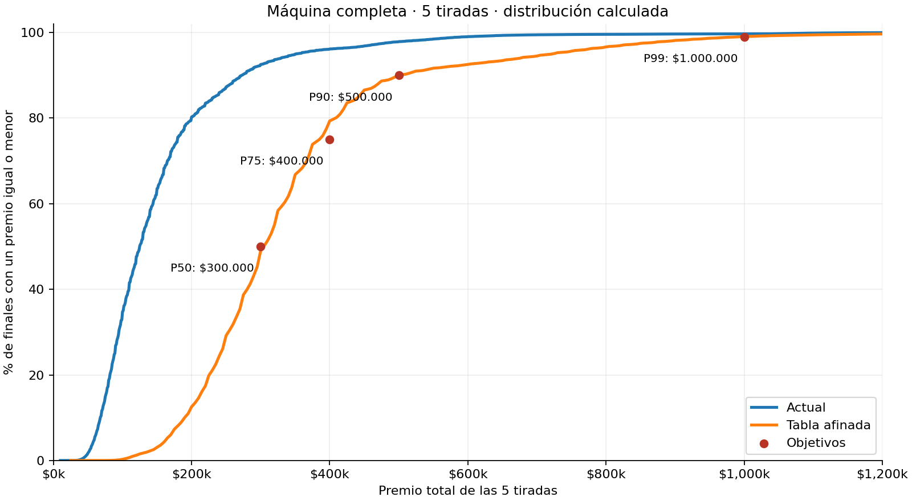

# Calibración de premios con máquina completa

**Escenario único: los 80 lugares completos y exactamente 5 tiradas pagadas.** Los percentiles corresponden a la suma de esas cinco tiradas; no a una tirada individual ni a una mezcla de partidas con distinta progresión.

Objetivos: P50 $300.000, P75 $400.000, P90 $500.000 y P99 alrededor de $1.000.000. $100.000 es una referencia de premio bajo, por debajo del P25, sin mínimo garantizado ni percentil exacto fijado.

La mejor candidata ensayada es **Tabla afinada**. La propuesta está guardada en `proposal.json`; **no está aplicada a la demo**. La búsqueda compara un escalado uniforme, una transformación que aumenta proporcionalmente más los pagos bajos, una tabla por cantidad y rango de símbolo, y un ajuste de sus celdas en pasos de $5.000. No se afirma un óptimo global.

| Modelo | P25 | Mediana | P75 | P90 | P99 | Total ≥ $1M |
|---|---:|---:|---:|---:|---:|---:|
| Actual | $89.000 | $125.000 | $180.000 | $273.000 | $600.000 | 0.3156% |
| Escalado uniforme | $155.000 | $220.000 | $310.000 | $470.000 | $1.025.000 | 1.1382% |
| Compresión de pagos | $225.000 | $295.000 | $395.000 | $540.000 | $995.000 | 0.9960% |
| Por cantidad y símbolo | $245.000 | $305.000 | $385.000 | $500.000 | $1.000.000 | 1.0008% |
| Tabla afinada | $245.000 | $305.000 | $390.000 | $500.000 | $1.000.000 | 1.0012% |



## Extremos y jackpots

- P1: $120.000; P5: $165.000; P10: $190.000.
- Probabilidad de total menor a $100.000: **0.1569%**; menor o igual: **0.2894%**.
- Probabilidad de acumular $1.000.000 o más: **1.0012%**. Puede ser la suma de premios menores; no equivale a sacar un jackpot en una tirada.
- Jackpot ordinario por tirada (pago ≥ $1M, excluyendo el excepcional): **0.0588%**. Al menos uno en cinco: **0.2934%**.
- Cuatro símbolos excepcionales naturales: **0.0006%** por tirada, o **0.0031%** al menos una vez en cinco. Conserva el premio de $5M.

## Tabla candidata

Valores por combinación antes del multiplicador. Los ids provienen del JSON. Se conserva la sustitución por Wild, la necesidad de un símbolo natural y el multiplicador no acumulable. Los cuatro símbolos excepcionales naturales siguen pagando $5M, por encima de la entrada ordinaria de su fila.

| id | 1 | 2 | 3 | 4 |
|---|---:|---:|---:|---:|
| lemon | $5.000 | $25.000 | $100.000 | $455.000 |
| orange | $5.000 | $25.000 | $100.000 | $575.000 |
| cherry | $10.000 | $75.000 | $100.000 | $675.000 |
| bell | $10.000 | $75.000 | $120.000 | $740.000 |
| diamond | $15.000 | $75.000 | $120.000 | $1.000.000 |
| seven | $25.000 | $95.000 | $120.000 | $1.000.000 |

## Verificación y reproducción

- Se enumeran todas las líneas posibles, ponderadas por la frecuencia de cada símbolo en los rodillos completos. Se calcula la distribución de la suma de cinco tiradas independientes mediante convolución finita. FFT usa aritmética de punto flotante; no se confunde este cálculo con una muestra de partidas.
- Las distribuciones por tirada de las 5 tablas se contrastaron con `analyzeSlots` del dominio, con tolerancia de 1e-12 por probabilidad.
- Validación independiente con **1,000,000 finales / 5,000,000 tiradas**, usando `spinSlots` real y una semilla distinta. Error máximo de CDF: 0.000802 (límite de comprobación 0.002693).
- Percentiles observados en esa simulación: P25 $245.000, P50 $305.000, P75 $385.000, P90 $500.000, P99 $1.000.000.
- No se simulan decisiones, rechazos, ruletas de desafíos ni máquinas incompletas. Tampoco se incluyen las tiradas de muestra sin premio. El comportamiento de esos escenarios no se valida en este experimento.
- Los percentiles son el menor importe cuya probabilidad acumulada alcanza el percentil indicado. Hay saltos porque los pagos son discretos; se informa por separado la probabilidad de alcanzar el millón.
- Se preservan composición, cantidad de tiradas, azar uniforme, reglas de pago, entradas ordinarias de $1M y premio excepcional de $5M. Sólo se buscan importes alternativos para las otras celdas de pago.
- El ajuste minimiza el error relativo cuadrático de los cuatro percentiles y la distancia de la probabilidad de total ≥ $1M al 1%; también evita situar $100.000 en o por encima del P25. No se fuerza un premio mínimo.

```bash
python -m pip install -r research/payout/requirements.txt
OPENBLAS_NUM_THREADS=1 python research/payout/calibrate.py
node research/payout/validate.mjs
python research/payout/report.py
```

Los objetivos y parámetros de búsqueda están en `experiment.json`. `results.json` contiene probabilidades, percentiles, semilla y hash del archivo de configuración de origen. `proposal.json` permite revisar la tabla antes de incorporarla. El archivo completo de distribuciones se genera en `artifacts/payout-search.json`.
