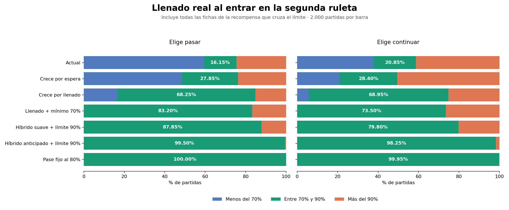

# Comparación de progresión entre ruletas

**112.000 partidas: 7 modelos × 4 perfiles × 2 decisiones × 2.000 semillas.**

Conclusión: el híbrido anticipado ofrece el mejor equilibrio de los modelos ensayados entre control del llenado, azar y conservación de la elección. El pase fijo al 80% controla mejor el resultado, pero elimina las llamas y la decisión. No se cambiaron las reglas de la demo.



## Resultado principal

Perfil de referencia: acepta 85% de las cartas, supera 70% de los retos binarios y resuelve los numéricos con distribución uniforme, igual que el simulador existente. Se muestran las partidas que eligen continuar en la tercera aparición.

| Modelo | Pase nominal 70–90% | Entrada real 70–90% | Completa en wheel_1 | Giros wheel_1, mediana |
|---|---:|---:|---:|---:|
| Actual | 20.85% | 20.85% | 33.30% | 26 |
| Crece por espera | 28.40% | 28.40% | 38.10% | 29 |
| Crece por llenado | 68.95% | 68.95% | 2.10% | 27 |
| Llenado + mínimo 70% | 73.50% | 73.50% | 2.20% | 27 |
| Híbrido suave + límite 90% | 100.00% | 79.80% | 0.00% | 26 |
| Híbrido anticipado + límite 90% | 100.00% | 98.25% | 0.00% | 25 |
| Pase fijo al 80% | 100.00% | 99.95% | 0.00% | 22 |

**Nominal y real son distintos:** si una recompensa cruza el límite, los modelos acotados incorporan sólo hasta el límite antes del pase; el excedente se acredita inmediatamente al entrar en wheel_2. La columna real incluye ese excedente. No se descartan fichas ni se oculta este salto.

## Modelo recomendado: híbrido anticipado

- Antes del 70%, permite acumular como máximo dos apariciones. Con dos, la categoría queda temporalmente con peso cero. Así no puede activar la decisión demasiado pronto.
- Chance base de avance: 14% hasta 69% de llenado, 35% al 70%, 65% al 80% y 90% al 90%, interpolando entre puntos. El tramo 69–70% es deliberadamente rápido: convendría suavizarlo visualmente o ensayar otra curva antes de implementarlo.
- Desde el 70%, cada giro que no da avance suma 3 puntos porcentuales, hasta 95%. Se reinicia al salir avance. Los giros anteriores al 70% no acumulan esa bonificación.
- Conserva la decisión en la tercera aparición y el pase en la cuarta, pero un límite de 72 posiciones fuerza el cambio aunque no hayan salido las llamas necesarias.
- Al cruzar el límite en una recompensa, separa las unidades excedentes y las incorpora después del cambio. Es una regla nueva del experimento, no una garantía que dé la ponderación por sí sola.

| Perfil | Decisión | Llenado nominal mediano | Entrada real en rango | Límite forzado | Opción ofrecida | Giros mediana / p95 |
|---|---|---:|---:|---:|---:|---:|
| Referencia | Pasa | 75.00% | 99.50% | 1.10% | 98.90% | 23 / 30 |
| Referencia | Continúa | 78.75% | 98.25% | 2.90% | 99.00% | 25 / 32 |
| Pocas recompensas | Pasa | 72.50% | 100.00% | 0.05% | 99.95% | 54 / 77 |
| Pocas recompensas | Continúa | 73.75% | 99.90% | 0.10% | 99.95% | 56 / 77 |
| Muchas recompensas | Pasa | 78.75% | 97.05% | 5.00% | 95.00% | 16 / 18 |
| Muchas recompensas | Continúa | 82.50% | 92.55% | 11.75% | 94.80% | 17 / 19 |
| Muy pocas recompensas | Pasa | 71.25% | 100.00% | 0.00% | 100.00% | 186 / 280 |
| Muy pocas recompensas | Continúa | 72.50% | 100.00% | 0.00% | 100.00% | 188 / 273 |

El límite mantiene el pase nominal entre 70% y 90% por construcción: observar 100% en la simulación no es la prueba de esa garantía; lo es limitar las inserciones y bloquear las transiciones anteriores al mínimo. Hay pruebas de conservación, exceso de recompensa y continuación.

**El rango real no queda garantizado si se acredita el excedente inmediatamente.** En el caso de referencia que continúa, el 98,25% entra dentro de 70–90% (IC 95%: 97,58–98,74%). Incluso el pase fijo al 80% tiene una excepción por una recompensa grande: 99,95% en rango. Para exigir también un 90% real estricto habría que conservar el excedente en una reserva hasta una recompensa posterior en wheel_2. Esa variante no fue simulada y requeriría decidir qué hacer si finale sale antes de cobrarla.

## Costo en duración y fase final

Los perfiles son supuestos de sensibilidad, no datos observados de jugadores:

| Perfil | Acepta | Éxito binario | Numérico |
|---|---:|---:|---|
| Referencia | 85.00% | 70.00% | Uniforme 0…máximo |
| Pocas recompensas | 50.00% | 40.00% | Binomial(máximo, probabilidad de éxito) |
| Muchas recompensas | 100.00% | 95.00% | Binomial(máximo, probabilidad de éxito) |
| Muy pocas recompensas | 20.00% | 25.00% | Binomial(máximo, probabilidad de éxito) |

Con muy pocas recompensas, el híbrido necesita alrededor de 186–188 giros para pasar; el percentil 95 llega a 273–280. No se puede garantizar un mínimo de llenado, respetar todas las recompensas existentes y a la vez garantizar partidas cortas si casi no se ganan fichas. Con rechazo permanente no se avanza: se probó y se registra como timeout, no como éxito.

wheel_2 conserva 10% de finale y los premios de sus cartas. Su duración esperada es 10 giros, incluido el de cierre; puede cerrar en el primer giro. Los mínimos/máximos de 3–5 tiradas finales ya vienen impuestos por la demo y no acreditan por sí mismos un buen balance.

| Perfil (continúa) | Llenado final mediano | Completa al final | Tiradas finales medianas | Premio final mediano |
|---|---:|---:|---:|---:|
| Referencia | 97.50% | 47.40% | 5 | 101,000 |
| Pocas recompensas | 82.50% | 14.55% | 5 | 80,000 |
| Muchas recompensas | 100.00% | 68.20% | 5 | 112,000 |
| Muy pocas recompensas | 75.00% | 0.40% | 4 | 60,000 |

Los pagos siguen siendo provisionales: este experimento evalúa progresión, no recalibra los premios al objetivo de mediana 250.000. Tampoco estima jackpots raros con precisión suficiente.

## Definición de los modelos

1. **Actual:** categorías equiprobables (1/7), tercera aparición permite pasar, cuarta obliga.
2. **Espera:** comienza en 3%; suma 2,5 puntos por cada giro sin avance y reinicia al salir; máximo 75%. Sin límites de llenado.
3. **Llenado:** curva lineal entre (0%, 5%), (50%, 5%), (70%, 15%), (80%, 35%), (90%, 70%), (100%, 95%). Sin límites.
4. **Llenado con mínimo:** la misma curva, pero impide la tercera aparición antes del 70%. Sin límite superior.
5. **Híbrido suave:** mínimo 70%, curva anterior, +2 puntos por espera desde 70%, techo 90% de probabilidad, límite de llenado 90%.
6. **Híbrido anticipado:** el recomendado, descrito arriba. Su objetivo es llegar al 70% con llamas ya acumuladas, reduciendo los pases forzados.
7. **Pase fijo:** elimina la categoría de avance y pasa automáticamente al incorporar 64 posiciones. Incluye el mismo tratamiento del excedente. Las dos decisiones son aquí bloques independientes de semillas; no hay elección.

## Reproducibilidad y límites

```bash
npm test
npm run simulate:progression -- --games 2000 --seed 20261028 --out research/progression/results.json
python research/progression/report.py  # requiere matplotlib; sólo para la figura y este informe
```

- Parámetros: [models.json](models.json). Resultados completos e intervalos: [results.json](results.json).
- Se usa la grilla real, sus explosiones y reemplazos, las cuotas reales de inserción, las cartas sin repetición hasta agotar el mazo, las recompensas configuradas y el evaluador real de premios.
- El runner omite las fases visuales y las tiradas de muestra sin premio. La secuencia exacta de una semilla no será la de la UI, porque las muestras consumen azar allí; la distribución de las reglas pagadas se conserva.
- Una prueba compara trazas, inventarios, decisiones y premios contra la máquina de estados de producción con esas mismas fases visuales omitidas. No se reemplazó la grilla por una ganancia promedio.
- 2.000 partidas independientes por escenario, mismas semillas por modelo dentro de cada perfil/decisión. Los JSON incluyen hashes SHA-256 de los tres archivos de contenido y todos los parámetros.
- No hubo timeouts en las 112.000 partidas hasta el límite de 1.000 giros totales. El test de rechazo permanente verifica explícitamente el caso que sí se atasca.
- Intervalos Wilson marginales al 95%, sin corrección por comparaciones múltiples. Con 2.000 muestras el error máximo es aproximadamente ±2,2 puntos porcentuales. Un cero observado no prueba imposibilidad salvo donde exista una regla que la imponga.
- Los agregados pesan los perfiles por igual sólo como resumen sintético. Las conclusiones se apoyan en los escenarios separados, no en una supuesta mezcla real de jugadores.
- Se midieron giros, no minutos: no están definidas las duraciones humanas de los desafíos. La comparación no garantiza el mismo balance con futuros mazos.
